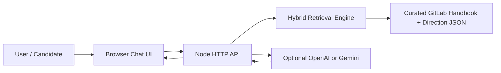

# Architecture

## System Overview

## Retrieval Pipeline

1. **Normalize query**: lowercase, tokenize, stem simple endings, expand domain synonyms such as `async`, `DevSecOps`, `direction`, and `AI`.
2. **Chunk sources**: each source becomes overview, evidence, and employee-use-case chunks.
3. **Score chunks**: combine BM25, TF-IDF cosine similarity, tag overlap, source weights, and intent boosts.
4. **Diversify sources**: prefer useful coverage across multiple source pages instead of repeating the same page.
5. **Generate answer**: produce deterministic grounded wording, or call OpenAI/Gemini when an API key is available.
6. **Guardrail**: refuse unsupported or prompt-injection requests.

## Why This Stands Out

- The project does not depend on an API key to work during evaluation.
- The UI exposes confidence, mode, source relevance, and source sections.
- `npm run eval` creates a repeatable quality signal for common candidate/employee questions.
- The architecture can grow into embeddings/vector DB later without changing the product surface.
